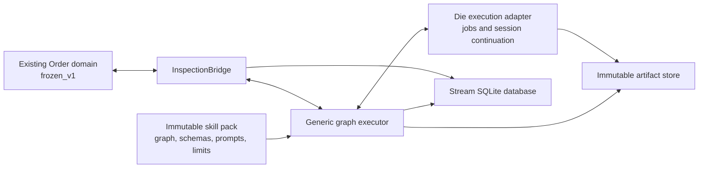

# Universal Review Execution Engine
## Greenfield design: a closed interpreter for declarative skill-pack graphs

**Proposal:** introduce a methodology-neutral execution engine inside the `Inspecting` phase. The engine executes a finite graph using six node types. Packs supply prompts, schemas, routing, counters, budgets, and artifact policies.

BMad’s four review categories, five-loop limit, KEEP instructions, and same-implementer patch policy exist only in pack data. The Rust domain continues to own order transitions and knows nothing about these concepts.

This document is a design proposal, not an implementation or a report of passing tests.

---

## 1. Requirements substrate: measured facts and their consequences

Only `crates/` and the permitted BMad `step-04-review.md` were inspected. No prior design document, skill entrypoint, or agent was loaded.

### 1.1 Foundry observations

| Measured fact | Evidence | Design consequence |
|---|---|---|
| `frozen_v1()` contains **21 encoded edges**, counted directly from its constructor. | [workflow_encoding.rs](/home/cosmo/foundry/crates/foundry-domain/src/workflow_encoding.rs:126) | Review execution must not add domain edges. |
| `InspectionPassed` moves `Inspecting → FurnaceHold`. Ordinary `InspectionFailed` retries through `Queued`, or fails at the attempt ceiling. A `no-op` reason has separate terminal semantics. | [order.rs](/home/cosmo/foundry/crates/foundry-domain/src/order.rs:283) | Internal review loopbacks cannot use `InspectionFailed`: doing so would consume domain attempts and restart the line. |
| The domain attempt ceiling is three. | [order.rs](/home/cosmo/foundry/crates/foundry-domain/src/order.rs:185) | Domain attempts and pack counters must be distinct persisted quantities. |
| The inspected `Inspector::inspect` implementation distinguishes empty and nonempty diffs; a nonempty diff passes. | [inspector.rs](/home/cosmo/foundry/crates/foundry-domain/src/inspector.rs:45) | This code does not establish a substantive review contract. The supplied “cargo-check-level” description is background context, not a claim that this function runs `cargo check`. |
| `Harness::run` receives an order, attempt, and workdir. `DieOutput` contains commits and exit information, but no worker-session identity or continuation operation. | [ports.rs](/home/cosmo/foundry/crates/foundry-domain/src/ports.rs:94) | Same-implementer continuation needs a new, generic harness capability. It cannot be inferred from a role name or commit. |
| The CLI harness starts an external process with a workdir and an environment allowlist. | [harness-cli/lib.rs](/home/cosmo/foundry/crates/foundry-harness-cli/src/lib.rs:64) | Reuse the process boundary, but do not mistake it for complete filesystem isolation or durable session support. |
| `finish_die_segment` currently binds the Die output, then dispatches `DieSucceeded` and `InspectionPassed` consecutively. | [stream.rs](/home/cosmo/foundry/crates/foundry-orch/src/stream.rs:668) | This path must stop after entering `Inspecting` and launch the pack instead of automatically passing inspection. |
| SQLite journal append reads the chain head and inserts under `BEGIN IMMEDIATE`. Its current API owns its transaction. | [sqlite.rs](/home/cosmo/foundry/crates/foundry-ledger/src/sqlite.rs:312) | The new execution records require a transaction-composable persistence API. Calling the existing append API alongside a separate execution commit is insufficient. |

One further integration constraint follows from the actual transition table: `Inspecting` has no cancellation transition. The proposed engine must not invent one or disguise cancellation as a `no-op` failure.

### 1.2 BMad observations

The inspected source was:

[step-04-review.md](/home/cosmo/.agents/skills/bmad-build/step-04-review.md)

SHA-256:

```text
170bbabde8a2a1172db409e56d1efa5e9d4f03ae8e7ea12c96d680c448d1aca6
```

Its relevant requirements are:

1. Launch active lenses together; collect all results before classification.
2. Reviewers use the current session’s model capability.
3. Classify every finding before grouping.
4. Preserve qualifying previously logged findings as `carried`; never patch or defer them again.
5. Route surviving groups to `intent_gap`, `bad_plan`, `patch`, or `defer`.
6. Process categories in cascading priority: `intent_gap`, then `bad_plan`, otherwise `patch` and `defer`.
7. Both loopback categories increment the **same** counter before acting. Missing means zero; a value exceeding five HALTs.
8. `intent_gap`: revert code, obtain human resolution, rerun planning, implementation, and review.
9. `bad_plan`: extract KEEP before reverting code; amend non-frozen planning sections while respecting the existing change log; record the amendment and KEEP; reimplement and review.
10. `patch`: continue the actual implementation subagent. If continuation is unavailable, the coordinating actor applies the patch. Reverify and rewrite the diff.
11. `defer`: append new entries without searching for duplicates or modifying existing entries.
12. If reviewer subagents are unavailable, export standalone reviewer prompts and HALT for human-run reviews.

These behaviors come from [classification and routing](/home/cosmo/.agents/skills/bmad-build/step-04-review.md:51) and [patch/defer processing](/home/cosmo/.agents/skills/bmad-build/step-04-review.md:87).

**Important interpretation:** the source does not prescribe an automatic full review loop after `patch`. Its explicit next actions are verification, diff regeneration, then presentation. This design preserves that distinction.

Everything below is a proposed design inferred from these requirements.

---

## 2. Architectural boundary



There are three separate authorities:

| Authority | Owns | Must not own |
|---|---|---|
| Order domain | Legal order transitions and domain attempt accounting | Review categories, KEEP, review loop limits |
| Execution engine | Graph mechanics, durable execution, isolation, limits, typed effects | Meaning of findings or methodology-specific routing |
| Pack | Review procedure and policy | Direct domain mutation, arbitrary engine extensions |

### Core invariants

1. Every active review run is bound to one order inspection epoch.
2. While the run is active or waiting, the order remains `Inspecting`.
3. Internal execution never emits `OrderEvent`.
4. Only the bridge translates a completed inspection result into a domain event.
5. A run executes the exact pack digest captured at admission.
6. A worker can return data and artifacts, but cannot choose an arbitrary next node.
7. Recovery never reevaluates an already committed model judgment.

**Why:** separating business lifecycle, execution mechanics, and methodology prevents “coded BMad” while retaining enforceable operational guarantees.

“Universal” here means universal within the declared operation contract. A future methodology requiring a genuinely new external capability may require an ABI revision; no finite engine can honestly promise to support every conceivable operation forever.

---

## 3. Pack data model

A pack is an immutable, content-addressed bundle:

```text
pack/
  manifest.json
  graph.json
  schemas/
  prompts/
  templates/
  fixtures/
```

YAML may be an authoring format. The loader converts it into a canonical, typed JSON representation before hashing or execution.

### 3.1 Minimum concepts

| Concept | Purpose | Why required |
|---|---|---|
| Typed inputs and state | Store refs, results, counters, handles, and decisions | Makes routing checkable and recovery explicit |
| Finite graph | Defines sequencing and branching | Keeps procedure in data |
| Immutable resources | Prompts, schemas, document templates | Makes methodology reproducible and digest-bound |
| Capability requirements | Declares needed worker and artifact operations | Prevents silently degrading unsupported behavior |
| Limits | Bounds steps, jobs, time, storage, and response sizes | A graph may contain cycles or invoke faulty workers |
| Named outputs | Returns an inspection result and artifact evidence | Keeps domain integration independent of methodology |

No separate general-purpose rule engine, plugin registry, embedded scripting language, or recursive workflow language is required.

### 3.2 Representative manifest

```yaml
format: foundry.pack/v1
engine_abi: foundry.graph/v1
id: example.bmad.full-review

entry: begin_review

inputs:
  code_base: RevisionRef
  code_candidate: RevisionRef
  plan: DocumentRef
  implementer: WorkerHandle
  coordinator: WorkerHandle
  model_capability: CapabilityRef
  review_configuration: ReviewConfiguration

state:
  review_loop_iteration:
    type: uint
    initial: 0
    write_policy: monotonic
  code:
    type: RevisionRef
    initial: {input: code_candidate}
  plan:
    type: DocumentRef
    initial: {input: plan}
  implementer:
    type: WorkerHandle
    initial: {input: implementer}
  triage_history:
    type: JournalRef
  plan_change_history:
    type: JournalRef

limits:
  node_activations: 1000
  external_dispatches: 100
  concurrent_jobs: 8
  effect_delivery_attempts: 3
  response_bytes: 1048576
  active_runtime_seconds: 14400

requires:
  - job.start
  - workspace.isolated
  - artifact.diff
  - document.project

optional:
  - job.continue
  - job.parallel

resources:
  triage_prompt: prompts/triage.md
  patch_prompt: prompts/patch.md
  finding_schema: schemas/finding.json
  triage_schema: schemas/triage.json
```

The numerical infrastructure limits above are illustrative deployment values, not measured BMad requirements.

The BMad limit of five belongs to its graph. Infrastructure limits are independent and are capped by host policy:

```text
effective_limit = min(pack_request, host_allowance)
```

**Why:** a methodology author controls its procedure but cannot grant itself unlimited resources.

### 3.3 Values and expressions

Supported values:

- bounded integers, booleans, strings, enums;
- bounded lists and records;
- immutable artifact references;
- opaque worker handles;
- authenticated human-response references.

Supported expressions:

- field access;
- equality and ordered comparisons;
- Boolean operators;
- checked integer addition;
- bounded list filtering and projection;
- `length`, `any`, and `all`;
- literal record construction.

There are no recursive functions, user-defined executable functions, dynamic evaluation, filesystem access, or network access in expressions.

Expressions are total over well-typed inputs. Overflow, missing required fields, or size-limit violations produce explicit execution errors.

**Why:** the engine needs enough computation to route and account, without becoming a second programming runtime.

### 3.4 Three artifact classes

A run distinguishes:

1. **Code revisions:** candidate source trees.
2. **Control documents:** plan, resolved intent, KEEP, and change logs.
3. **Evidence:** diffs, findings, verification receipts, and deferred-work entries.

All are versioned independently.

A code rollback updates the selected code revision. It does not rewind execution state or control documents.

**Why:** resetting one Git worktree indiscriminately could erase the counter, KEEP, and evidence that explain why the rollback occurred.

When control documents must appear inside a repository, they are materialized from their retained references after selecting the code revision. The workspace manifest makes this overlay explicit.

---

## 4. Closed engine operation set

The engine has **six node types**.

| Node | Semantics | Why it exists |
|---|---|---|
| `update` | Atomically assign typed state and append execution records | State and evidence changes need durable, replayable semantics |
| `branch` | Select the first matching declared edge, with a required default | Routing must remain pack data |
| `effect` | Request one operation from the closed external-effect contract | External work cannot run inside a SQLite transaction |
| `parallel` | Execute a bounded group of effect children and join their results | Review lenses need explicit launch and completion barriers |
| `wait` | Persist an authenticated external-input request and suspend | Human intervention must survive process loss |
| `finish` | Return a typed result and seal the run | Completion must be distinguishable from suspension |

### 4.1 The effect vocabulary is also closed

`effect` does not conceal an open-ended Rust action registry.

Its four operation tags are:

| Effect operation | Contract |
|---|---|
| `job.start` | Start one worker job using a declared execution profile |
| `job.continue` | Send one request to an existing worker session |
| `artifact.diff` | Produce a diff artifact from declared revision references |
| `document.project` | Materialize a declared document version or append projection |

A job profile is either a process job or an agent job, with bounded input, output schema, workspace access, timeout, and resource limits.

Examples:

- A compiler check is a process job.
- Triage is an agent job.
- Replanning is an agent job.
- Patch application is a continuation job.

The engine does not have `triage`, `replan`, `rollback_bmad`, `KEEP`, or `defer` actions.

Selecting an earlier code revision is an `update` to a typed artifact reference. Preparing the associated private workspace is a generic prerequisite of the next job.

### 4.2 Closure rules

The ABI rejects:

- unknown node or effect tags;
- native pack plugins;
- executable routing hooks;
- dynamic node creation;
- arbitrary “next node” values returned by workers;
- recursive graph imports.

A pack may reuse a graph fragment, but the loader expands it into a finite graph before admission.

A worker prompt can ask for analysis or edits. It cannot delegate ownership of the whole durable workflow to that worker. Loop counts, routing, waits, and continuation selection must remain visible in the graph.

**Why:** otherwise an apparently universal `run_anything` node merely hides BMad inside an unobservable external program.

### 4.3 Why six?

Six is a practical semantic boundary, not a mathematical lower-bound claim.

- `branch` could be fused into `update`, but that would obscure routing.
- `parallel` could be expanded into lower-level tokens, but launch/join semantics would become harder to validate.
- `wait` could resemble an external effect, but authenticated human responses have a different lifecycle.
- Adding a separate node for every review action would encode methodology in the engine.

There are six control-node variants and four external-effect variants. Both sets are explicit and versioned; the operation count is not hidden behind an unlimited `action` string.

---

## 5. Durable execution contract

### 5.1 Execution identity

A run is identified by:

```text
run_id
stream_id
order_id
domain_attempt
inspection_epoch
pack_digest
engine_abi
```

Its durable state includes:

```text
run_version
status
ready activations
typed state
artifact references
worker handles
outstanding effects
wait requests
budget usage
terminal result, if any
```

An **activation** identifies one visit to a node. It is not merely the node’s name: the same node may execute in several review rounds.

```text
effect_id = hash(run_id, activation_id, effect_slot)
```

Delivery retries reuse `effect_id`. A genuinely new invocation receives a new activation and effect identity.

**Why:** retrying delivery and repeating a methodology step are different events.

### 5.2 SQLite ownership

The stream’s SQLite database contains:

- execution events;
- rebuildable run projections;
- pending effects;
- effect receipts;
- worker-handle bindings;
- waits and consumed response IDs;
- terminal-delivery deduplication records.

Execution events are separate from `OrderEvent` rows. They may use a separate hash-chained execution table in the **same database**, with explicit references to relevant domain rows.

The existing domain replayer continues to see only domain events.

**Why:** internal pack progress must be auditable without pretending that each node is an order transition.

### 5.3 A normal node commit

Within one SQLite transaction:

1. Check run version and execution lease.
2. Check that the inspection epoch remains current.
3. Check budgets.
4. Validate the activation’s preconditions.
5. Apply its state changes.
6. Append execution events.
7. Create successor activations or effect-outbox rows.
8. Update the rebuildable run projection.
9. Commit.

No subprocess, model call, or human wait occurs inside this transaction.

In-memory state becomes authoritative only after commit.

### 5.4 External effects

External work follows a durable request/receipt protocol:

```text
SQLite: commit effect intent
    ↓
Adapter: dispatch or reconcile effect_id
    ↓
Adapter: durably store result and immutable artifacts
    ↓
SQLite: accept receipt, update run, activate successors
```

A successful receipt includes:

```text
effect_id
request_digest
input_revision
worker_handle, where applicable
result_revision, where applicable
structured_output_digest
execution_profile_digest
fencing_generation
```

The engine checks the receipt before accepting it.

Artifacts are durably stored before their references are committed. A crash can leave an unreferenced artifact, which can be garbage-collected. It must not leave a committed reference to an undurable artifact.

### 5.5 Exactly-once claims

The engine guarantees:

- one accepted result per effect identity;
- one committed state transition per activation;
- one consumed response per wait;
- one terminal delivery per run.

It does **not** claim universal exactly-once external execution.

An adapter must provide one of:

1. idempotent submission and result lookup;
2. safe repeat execution in a fresh isolated workspace;
3. an explicit “outcome unknown” state requiring reconciliation.

For a worker-session message, repeating it may alter conversational state twice. If the provider cannot deduplicate or look up the message outcome, the engine holds instead of blindly resending.

**Why:** SQLite cannot atomically commit with an arbitrary process or model provider.

### 5.6 Crash recovery

| Crash window | Recovery |
|---|---|
| Before effect intent commits | No effect exists; activate normally |
| After intent commits, before dispatch | Dispatch the persisted request |
| After dispatch, before receipt | Reconcile by `effect_id`; do not assume failure |
| After artifact creation, before result acceptance | Validate and accept the existing receipt |
| After result acceptance | Replay the committed result; do not rerun the job |
| After wait creation | Redisplay the same durable wait |
| After response consumption | Continue from its recorded successor |
| During terminal delivery | Deduplication and one SQLite transaction prevent double domain delivery |

Replay is deterministic over recorded events and receipts. It never calls an LLM to reconstruct a past decision.

### 5.7 Isolation and fencing

Each mutation job receives:

- a private writable code workspace;
- immutable input revision references;
- explicit writable document scopes;
- an execution-generation fence;
- no direct ledger or domain access.

Parallel review lenses receive the same immutable candidate, with no shared writable source tree.

A candidate result is adopted only if its expected input revision is still current. A stale worker may finish, but its result cannot overwrite a later candidate.

Lease fencing protects result acceptance. Private workspaces additionally prevent an expired worker from corrupting another worker’s live tree.

Process profiles must enforce their declared filesystem and network capabilities. Merely setting `current_dir` is insufficient for that contract.

### 5.8 Worker identity and continuation

`WorkerHandle` is an opaque adapter-issued value bound to:

```text
provider
session identity
originating start effect
execution profile
tenant/run authorization
```

A successful `job.continue` must attest continuation of that same session.

These are not equivalent:

```text
same role
same prompt
same model
same name chosen for a fresh session
same durable session identity
```

Only the last satisfies BMad’s patch continuation rule.

Provider outcomes distinguish:

- `completed`;
- `continuation_unavailable`;
- `failed`;
- `outcome_unknown`.

Only a definite `continuation_unavailable` permits the pack’s fallback. An unknown outcome must be reconciled first.

### 5.9 Human hold/resume

A wait stores:

```text
wait_id
run_id and run_version
request schema
evidence and artifact digests
authorized responder policy
allowed response-to-edge mapping
```

A response must match the wait identity and its bound context. Consumption, state updates, and successor activation occur in one transaction.

A response cannot supply arbitrary node names, reset budgets, or replace the pack.

A stale response is rejected with the current wait reference.

**Why:** a human resolving yesterday’s intent must not accidentally authorize changes against today’s candidate.

### 5.10 Finiteness

Every run has a mandatory finite node-activation budget. All activations, including loopbacks and repeated waits, consume it. External dispatches and retries have separate finite budgets.

Therefore, even a graph with an accidental cycle cannot execute indefinitely.

Additional guarantees:

- bounded fan-out;
- bounded expression evaluation;
- bounded job runtime;
- bounded outputs;
- bounded automatic retry;
- no budget reset on resume or recovery.

Budget exhaustion creates an execution hold and stops automatic work. It does not imply inspection failure or success.

Human waiting may last indefinitely. That is suspended computation, not an infinite execution loop. The engine guarantees bounded autonomous work, not eventual human response or eventual approval.

---

## 6. BMad FULL as pack data

The following example describes the substantive routing graph. The format uses `$x` as shorthand for a typed reference expression.

Job names such as `triage` and `amend_plan` refer to prompt/profile resources in the pack. They are not engine opcodes.

### 6.1 Imported execution context

The initial inspection receives:

- baseline code revision;
- implemented candidate revision;
- plan document;
- implementation worker handle;
- coordinating worker handle;
- resolved review configuration.

The handle must come from actual step-03 execution. An existing installation that recorded only `result_commit` cannot reconstruct it honestly.

The generic provenance contract must therefore record worker handles during implementation as well as during inspection.

If a legacy run has no implementation handle, the pack follows the explicit unavailable-continuation fallback. It must not label a newly launched implementer as the original one.

### 6.2 Main routing graph

The readable representation below omits repetitive input-schema declarations. Every referenced job and document template must be present and digest-bound at load time.

```yaml
nodes:
  begin_review:
    type: update
    set:
      review_status: in-review
    next: stage_diff

  stage_diff:
    type: effect
    operation: artifact.diff
    input:
      base: $input.code_base
      candidate: $state.code
      include_untracked: true
    bind: diff
    next: reviewer_mode

  reviewer_mode:
    type: branch
    cases:
      - when: $capabilities.job_parallel_available
        next: review_lenses
    default: export_manual_reviews

  review_lenses:
    type: parallel
    items: $configuration.active_lenses
    child:
      type: effect
      operation: job.start
      profile: $item.profile
      prompt: $item.prompt
      model_capability: $input.model_capability
      input:
        diff: $diff
        code: $state.code
        permitted_context: $item.context_bindings
    join: all
    output_order: declared
    bind: lens_results
    next: triage

  export_manual_reviews:
    type: effect
    operation: document.project
    template: standalone-review-prompts
    input:
      lenses: $configuration.active_lenses
      diff: $diff
      code: $state.code
      permitted_context: $configuration.lens_contexts
    bind: exported_reviews
    next: await_manual_reviews

  await_manual_reviews:
    type: wait
    request: $exported_reviews
    response_schema: all-lens-reports
    bind: lens_results
    responses:
      submitted: triage
      abort: inspection_rejected

  triage:
    type: effect
    operation: job.start
    profile: coordinating-analysis
    prompt: triage
    input:
      code: $state.code
      plan: $state.plan
      findings: $lens_results
      previous_rows: $state.triage_history
    output_schema: triage-result
    bind: triage_result
    next: record_triage

  record_triage:
    type: update
    append:
      triage_history: $triage_result.rows
    set:
      actionable: $triage_result.actionable
    next: route

  route:
    type: branch
    cases:
      - when: {nonempty: $state.actionable.intent_gap}
        next: select_intent_gap
      - when: {nonempty: $state.actionable.bad_plan}
        next: select_bad_plan
      - when: {nonempty: $state.actionable.patch}
        next: patch_same_implementer
    default: record_deferrals

  select_intent_gap:
    type: update
    set:
      loop_reason: intent_gap
    next: count_loopback

  select_bad_plan:
    type: update
    set:
      loop_reason: bad_plan
    next: count_loopback

  count_loopback:
    type: update
    add:
      review_loop_iteration: 1
    next: project_counter

  project_counter:
    type: effect
    operation: document.project
    template: plan-review-counter
    input:
      plan: $state.plan
      value: $state.review_loop_iteration
    bind: counter_updated_plan
    next: adopt_counter_plan

  adopt_counter_plan:
    type: update
    set:
      plan: $counter_updated_plan
    next: loop_limit

  loop_limit:
    type: branch
    cases:
      - when: {gt: [$state.review_loop_iteration, 5]}
        next: loop_limit_halt
      - when: {eq: [$state.loop_reason, intent_gap]}
        next: restore_for_intent
    default: extract_keep

  loop_limit_halt:
    type: wait
    request_template: review-loop-limit-exceeded
    response_schema: stop-response
    responses:
      stop: inspection_rejected
```

The limit HALT has no automatic edge back to replanning.

Human intervention may initiate separately authorized manual work or a new execution, but an ordinary resume cannot make `6 ≤ 5`, erase the existing count, or silently grant another five loopbacks.

### 6.3 `intent_gap`

```yaml
  restore_for_intent:
    type: update
    set:
      code: $input.code_base
    next: resolve_intent

  resolve_intent:
    type: wait
    request_template: resolve-frozen-intent
    input:
      findings: $state.actionable.intent_gap
      current_plan: $state.plan
    response_schema: resolved-intent
    bind: intent_resolution
    responses:
      resolved: adopt_resolved_intent
      abort: inspection_rejected

  adopt_resolved_intent:
    type: update
    set:
      resolved_intent: $intent_resolution
    append:
      intent_history: $intent_resolution
    next: replan

  replan:
    type: effect
    operation: job.start
    profile: planning
    prompt: step-02-plan
    input:
      previous_plan: $state.plan
      resolved_intent: $state.resolved_intent
      plan_change_history: $state.plan_change_history
    output_schema: plan-result
    bind: new_plan
    next: adopt_replanned_document

  adopt_replanned_document:
    type: update
    set:
      plan: $new_plan.document
    next: implement
```

The response creates a new intent revision with human provenance; it does not overwrite the historical frozen intent.

The planning resource must embody the step-02 procedure, including any necessary planning interaction as explicit graph waits. A prompt saying “perform all future workflow steps” is not an acceptable substitute.

**Why:** the human resolves intent; the engine only validates the response contract and follows the declared edge.

### 6.4 `bad_plan`: KEEP before rollback

```yaml
  extract_keep:
    type: effect
    operation: job.start
    profile: coordinating-analysis
    prompt: extract-positive-preservation
    input:
      candidate: $state.code
      plan: $state.plan
      findings: $state.actionable.bad_plan
    output_schema: keep-instructions
    bind: keep
    next: preserve_keep_and_restore

  preserve_keep_and_restore:
    type: update
    append:
      keep_history: $keep
    set:
      current_keep: $keep
      known_bad_revision: $state.code
      code: $input.code_base
    next: amend_plan

  amend_plan:
    type: effect
    operation: job.start
    profile: planning
    prompt: amend-nonfrozen-plan
    input:
      plan: $state.plan
      findings: $state.actionable.bad_plan
      keep: $state.current_keep
      previous_constraints: $state.plan_change_history
      known_bad_revision: $state.known_bad_revision
    output_schema: plan-amendment
    constraints:
      immutable_sections:
        - frozen-after-approval
    bind: amendment
    next: record_amendment

  record_amendment:
    type: update
    set:
      plan: $amendment.document
    append:
      plan_change_history:
        triggering_findings: $state.actionable.bad_plan
        amendment: $amendment.description
        avoided_state: $state.known_bad_revision
        keep: $state.current_keep
    next: implement

  implement:
    type: effect
    operation: job.start
    profile: implementation
    prompt: step-03-implement
    input:
      code: $state.code
      plan: $state.plan
      keep_history: $state.keep_history
      plan_change_history: $state.plan_change_history
    output_schema: implementation-result
    bind: implementation
    next: adopt_implementation

  adopt_implementation:
    type: update
    set:
      code: $implementation.result_revision
      implementer: $implementation.worker_handle
    next: begin_review
```

`immutable_sections` is a generic document constraint: the engine compares declared protected regions, not BMad semantics. The section name is pack data.

The KEEP result is committed before the code selection changes. If the process crashes after rollback, KEEP remains available.

The new implementation handle replaces the previous handle because subsequent patches must continue the implementer responsible for the current candidate.

**Why:** same-implementer identity follows the current implementation lineage, not the first worker ever used by the order.

### 6.5 `patch`: actual continuation, explicit fallback, verification

```yaml
  patch_same_implementer:
    type: effect
    operation: job.continue
    handle: $state.implementer
    prompt: exact-patch-message
    input:
      code: $state.code
      findings: $state.actionable.patch
    bind: patch_result
    outcomes:
      completed: adopt_patch
      continuation_unavailable: patch_by_coordinator
      failed: patch_execution_halt

  patch_by_coordinator:
    type: effect
    operation: job.continue
    handle: $input.coordinator
    prompt: apply-patches-yourself
    input:
      code: $state.code
      findings: $state.actionable.patch
    bind: patch_result
    outcomes:
      completed: adopt_patch
      continuation_unavailable: patch_execution_halt
      failed: patch_execution_halt

  adopt_patch:
    type: update
    set:
      code: $patch_result.result_revision
    next: verify_patched_code

  verify_patched_code:
    type: effect
    operation: job.continue
    handle: $input.coordinator
    prompt: verify-and-repair-if-possible
    input:
      code: $state.code
      verification_section: $state.plan.verification
    output_schema: verification-result
    bind: verification
    outcomes:
      completed: verification_route
      continuation_unavailable: patch_execution_halt
      failed: patch_execution_halt

  verification_route:
    type: branch
    cases:
      - when: $verification.passed
        next: adopt_verified_code
      - when: $verification.no_checks_defined
        next: adopt_verified_code
    default: patch_execution_halt

  adopt_verified_code:
    type: update
    set:
      code: $verification.result_revision
    append:
      verification_history: $verification
    next: rewrite_diff

  rewrite_diff:
    type: effect
    operation: artifact.diff
    input:
      base: $input.code_base
      candidate: $state.code
      include_untracked: true
    bind: diff
    next: record_deferrals

  patch_execution_halt:
    type: wait
    request_template: patch-or-verification-needs-human
    response_schema: stop-response
    responses:
      stop: inspection_rejected
```

The `exact-patch-message` resource contains the source-prescribed message:

```text
Review of your implementation found problems. Fix each one below with the smallest change that does the job.

Run only the tests that cover the files you edit — nothing wider. Full verification runs on my side after you return. Reply with what you changed.

- <file> — <what is wrong> — <what the smallest fix must do>
```

Workspace bindings and output-schema requirements travel in the execution envelope, not as extra conversational instructions appended to that message.

The coordinating session owns full verification. Its leaf job may execute checks and bounded local repair, but it cannot route back to planning or invoke another review round. Such control requires graph edges.

If the coordinating session itself is unavailable, the run holds. Launching a new worker and calling it “yourself” would misrepresent the fallback.

### 6.6 `defer` and completion

```yaml
  record_deferrals:
    type: update
    append:
      deferred_entries: $state.actionable.defer
    next: project_deferrals

  project_deferrals:
    type: effect
    operation: document.project
    template: deferred-work-append
    input:
      entries: $activation.recorded_deferred_entries
      source_plan: $state.plan
    next: present

  present:
    type: effect
    operation: job.continue
    handle: $input.coordinator
    prompt: step-05-present
    input:
      code: $state.code
      plan: $state.plan
      triage_history: $state.triage_history
      verification_history: $state.verification_history
      deferred_entries: $state.deferred_entries
    next: inspection_accepted

  inspection_accepted:
    type: finish
    result:
      decision: accepted
      candidate: $state.code
      evidence: $state.evidence_index

  inspection_rejected:
    type: finish
    result:
      decision: rejected
      reason: $state.stop_reason
      evidence: $state.evidence_index
```

All omitted effect errors have an explicit pack-wide expansion to an execution-error wait. Unknown external outcomes are held by the runtime until reconciled; they are not interpreted as successful or unavailable continuation.

Presentation completion is not publishing approval. `accepted` only permits the existing domain transition to `FurnaceHold`.

### 6.7 Triage policy is also pack data

The triage job’s prompt and output schema encode the source’s detailed rules:

| Policy | Pack representation |
|---|---|
| Verdict before grouping | One verdict row per input finding; group members reference those rows |
| Reviewers do not assign final severity | Triage prompt; reviewer severity excluded from routing authority |
| Previously logged unchanged finding | `carried_from` reference plus evidence; excluded from patch/defer action lists |
| Verification-gap trust exception | Prompt rule keyed by configured lens identity and finding kind |
| Reject false findings | Verdict and refutation fields |
| Reject disproportionate low-value fixes | Explicit disposition and reason |
| Scope determined by intent | Prompt rule and cited intent evidence |
| Shared-root-cause grouping | Group membership plus root-cause evidence |
| Four routes | Pack-defined enum |
| Mixed verified/unverified group | Route using the highest verified severity |
| Plan-edit proposals rejected | Explicit finding disposition rule |
| KEEP and change-log constraints | Planning prompts and required outputs |

The engine can mechanically enforce coverage, references, enum membership, and protected-document constraints. It cannot mechanically prove that an LLM correctly understood causality, intent, or severity.

**Why:** generic structural enforcement is possible; embedding a Rust classifier for BMad judgment would violate the central requirement.

### 6.8 Cascading semantics and retained findings

When an `intent_gap` or `bad_plan` exists:

- no patch is dispatched for that round;
- no deferral is appended for that round;
- findings and triage evidence remain in history;
- rederived code is reviewed again.

The source also says patch findings “survive loopbacks.” This design interprets that as retaining them as obligations/evidence for rederivation, rather than blindly applying old line-specific patches to a new code tree. A later review must assess their applicability.

This is an explicit design interpretation, not an extra measured rule.

### 6.9 Counter trace

A mixed sequence demonstrates the shared limit:

```text
initial                                      counter = 0
bad_plan → KEEP → restore → amend → implement counter = 1
intent_gap → restore → human → plan → implement
                                             counter = 2
bad_plan                                     counter = 3
bad_plan                                     counter = 4
intent_gap                                   counter = 5
next bad_plan                                counter = 6 → HALT
```

At six, KEEP extraction, rollback, and reimplementation do not begin.

All these actions remain within the same domain attempt. Patch, defer, delivery retries, and ordinary hold/resume do not increment this counter.

### 6.10 Review modes and unavailable reviewers

The example above represents FULL review. Configuration normalization also lives in the pack:

- `auto` selects thorough review and records `review_source: auto`;
- explicit modes record `review_source: pinned`;
- `none` records an empty lens list and proceeds to presentation;
- `quick` selects its configured lens list;
- `oneshot` selects the enclosing pack route that bypasses this review step.

The inspected source contains template placeholders for configured lenses. Their exact expanded inventory was not measured. A production pack must freeze the resolved lens resources rather than depend on mutable installed files.

For manual-review fallback, each exported prompt embeds the required file contents. Imported reports remain explicitly attributed to human-supplied external sessions; the engine cannot attest those sessions’ model identity.

---

## 7. Artifact and document semantics

### 7.1 Baseline and rollback

The run captures the baseline before mutable implementation work.

The inspected CLI implementation reads its `base` after the child process returns; consequently, the proposed runtime must not assume that field alone establishes a trustworthy pre-execution snapshot. The new contract captures and binds the actual input revision at dispatch.

Rollback means:

```text
selected_code_revision := captured_baseline
```

The old candidate remains an immutable artifact.

**Why:** this provides reproducible rollback, preserves evidence, and avoids destructive operations against a shared branch.

If no baseline exists, the BMad pack may first run its best-effort baseline-discovery job. If it cannot establish a restorable code snapshot, a rollback-dependent branch holds for human input. It must not claim to have reverted code.

### 7.2 Deferred-work append

Each newly executed deferral receives a stable record identity:

```text
(run_id, activation_id, entry_index)
```

The document projection appends:

```markdown
- source_plan: `<plan reference>`
  summary: <one sentence>
  evidence: <evidence or what would settle the claim>
```

Two distinct policies coexist:

- **Methodology:** do not search for semantically duplicate deferred entries.
- **Delivery:** do not append the same execution record twice after a crash.

These are different forms of duplication.

For a local document, one projection writer serializes updates, preserves the existing prefix byte-for-byte, creates the new version durably, and reconciles by expected/result digest after a crash. A concurrent external edit produces a projection conflict rather than an overwrite.

If several streams target the same document, projection uses a shared sink identity and serialized adapter ownership. Its completion remains an external receipt; cross-stream SQLite atomicity is not claimed.

### 7.3 Mutable files are projections

The authoritative loop counter, KEEP records, and triage rows live in execution state and immutable document revisions.

A materialized Markdown file is a projection. Resuming a run does not reread an edited frontmatter counter and thereby reset accounting.

External document edits must be imported as explicit new inputs or human responses.

**Why:** otherwise editing a file could bypass durable execution limits.

---

## 8. Mechanical verification of “pack swap, engine diff zero”

A digest alone does not prove methodological independence. Verification needs several complementary checks.

### 8.1 Load-time validation

The loader rejects a pack unless:

1. Every node and effect tag belongs to the closed ABI.
2. Every edge target exists.
3. Every reachable expression is typed.
4. Every branch has a default.
5. Required values are available on every incoming path.
6. Cyclic values have explicit initialization and merge semantics.
7. Fan-out and collections are bounded.
8. Limits are finite and within host policy.
9. All effects declare output and error contracts.
10. Worker continuation consumes a `WorkerHandle`, not a string label.
11. Artifact mutation scopes are declared.
12. All resources are included in the digest closure.
13. Domain-event emission is absent from the pack vocabulary.
14. Every externally visible finish value conforms to the generic inspection-result schema.

Cycle analysis identifies strongly connected components. Mandatory activation fuel makes every cycle bounded; optional monotonic counters provide stronger, pack-specific assertions.

### 8.2 Reproducible identity

Define:

```text
pack_digest =
  H(format_version,
    engine_abi,
    canonical_graph,
    schemas,
    prompts,
    templates,
    resource_digests)
```

Separately capture:

```text
execution_digest =
  H(pack_digest,
    engine_binary_digest,
    adapter_bundle_digest,
    host_policy_digest,
    input_artifact_digests,
    execution_profile_digests)
```

A pack swap changes the pack and execution digest. It must not require changing the engine or adapter bundle.

**Why:** hashing only the graph would allow a prompt or template to change the methodology invisibly.

### 8.3 One-binary, multiple-pack fixture

Build one engine binary, then run at least:

**Pack A — BMad FULL**

- cascading categories;
- shared five-loop allowance;
- same-session patch continuation;
- KEEP before rollback;
- human intent resolution;
- append-only deferral.

**Pack B — independent two-stage inspection**

```text
start deterministic checks
→ if failed, finish rejected
→ run one reviewer
→ if uncertain, wait for a human
→ finish accepted or rejected
```

Pack B has no BMad categories, plan amendment, KEEP, or review-loop counter.

Both must run in the same test process against the same effect adapters. Neither pack is compiled into Rust.

A third fixture using different routing and a different bounded loop strengthens the test beyond “BMad plus a trivial pass.”

### 8.4 Required BMad traces

| Fixture | Required assertion |
|---|---|
| No actionable findings | Accepted without patch or replan |
| Patch and defer | Same implementer continued; verification precedes deferral/presentation |
| Continuation unavailable | Coordinator fallback; no fresh implementer substitution |
| Continuation outcome unknown | Reconciliation hold; no premature fallback |
| Intent gap and bad plan together | Intent gap wins |
| Bad plan and patch together | KEEP and rederivation; no immediate patch |
| Alternating loopback categories | One shared counter |
| Sixth loopback request | Counter reaches six; no further automatic rederivation |
| Crash during counter processing | Increment occurs once |
| Crash after KEEP | KEEP retained across restoration |
| Carried finding | New carried row; no repeated patch/defer |
| Deferral replay | One append for the execution record |
| New equivalent deferral record | No semantic duplicate search |
| Stale human response | Rejected |
| Stale worker result | Not adopted |
| Pack changed during a hold | Original digest retained |
| Parallel lens timing inversion | Triage waits for every result |
| Final patched commit | Bridge binds the final candidate, not the initial Die commit |

### 8.5 Fault-injection and property tests

Inject failure before and after every durable boundary:

- outbox insertion;
- dispatch acknowledgement;
- artifact persistence;
- result acceptance;
- wait-response consumption;
- terminal domain delivery.

Verify:

```text
at most one accepted receipt per effect
at most one response consumption per wait
at most one domain completion per run
no published reference to an uncommitted candidate
no counter/budget decrease on recovery
no domain transition during internal loopback
```

Bounded abstract-state exploration can verify control properties independently of model quality. Model responses become nondeterministic schema-valid inputs.

### 8.6 Proving the engineering claim

CI records:

```text
engine binary digest before/after pack swap: identical
adapter bundle digest before/after:         identical
Rust source diff:                           empty
pack/resource diff:                         expected
all conformance fixtures:                   passing
```

An additional renaming test substitutes arbitrary route and state-field names in a pack and adjusts its resources. Behavior should remain equivalent modulo those names.

Dependency checks prohibit:

- pack crates as domain dependencies;
- pack-specific Rust modules;
- compiled prompt resources selected by pack ID;
- native plugin loading.

These checks establish that the supported methodologies execute without engine changes. They do not prove that every future methodology is expressible or that model judgments are correct.

---

## 9. Exact domain integration

There is **one logical integration component**, `InspectionBridge`, with two transaction entry points.

### 9.1 Entry: create an inspection run

When initial implementation succeeds:

```text
BEGIN
  verify current Working order and attempt
  validate implementation receipt
  apply existing DieSucceeded transition
  append existing domain event
  create inspection epoch
  bind pack digest and implementation provenance
  create run and entry activation
COMMIT
```

The order is now `Inspecting`.

A unique constraint on the inspection epoch makes repeated admission idempotent.

Creating the domain transition and the run in separate commits would permit an order to become stranded in `Inspecting`; the shared transaction prevents that.

### 9.2 Internal progress: no domain calls

During:

- review;
- triage;
- replanning;
- code restoration;
- reimplementation;
- patching;
- deferral;
- human waiting;
- resource-limit holds;

the executor writes execution records only.

```text
OrderState = Inspecting
domain attempt unchanged
domain version unchanged
```

The engine checks the inspection fence when accepting mutations, but does not invoke `Order::transition`.

### 9.3 Exit: deliver one inspection result

For an accepted result:

```text
BEGIN
  verify current Inspecting state and inspection epoch
  verify sealed run and undelivered terminal result
  verify final candidate and required evidence exist
  bind final artifact provenance
  apply existing InspectionPassed transition
  append existing domain event
  mark terminal result delivered
COMMIT
```

This moves the order to `FurnaceHold`.

For a rejected result:

```text
same transaction pattern
→ existing InspectionFailed { reason }
```

The domain retains its existing retry-or-fail decision.

The bridge generates the reason envelope. It does not allow arbitrary pack text to impersonate the special `no-op` taxonomy.

### 9.4 Holds are not failures

These do **not** automatically emit `InspectionFailed`:

- unresolved intent;
- sixth-loop HALT;
- missing continuation capability;
- uncertain external outcome;
- exhausted engine budget.

They remain observable execution holds inside `Inspecting`.

**Why:** mapping HALT to failure would consume a domain attempt, potentially launch a fresh inspection, and accidentally turn the five-loop ceiling into repeated sets of five.

An operator may explicitly reject the inspection, invoking the existing domain failure policy. That is a separate recorded decision.

An operator request to cancel while `Inspecting` cannot be fulfilled as a domain cancellation under the measured frozen table. Supporting that lifecycle behavior would require a separately approved domain change; this design does not smuggle it into pack semantics.

### 9.5 Initial integration work versus pack-swap work

Initial implementation requires generic changes:

- introduce the graph executor;
- extend execution adapters with durable job identity and continuation;
- add execution persistence and a composable SQLite transaction API;
- capture implementation-session provenance;
- replace automatic inspection passage with the bridge;
- bind the final reviewed candidate.

These are **one-time infrastructure changes**.

After this ABI exists, switching BMad to another compatible pack requires no changes to the domain, executor, bridge, or adapters.

The proposal does not claim the existing code already supplies this engine.

---

## 10. Acceptance criteria

The design is realized only when all of the following hold:

1. The domain’s 21-edge encoding remains unchanged.
2. No Rust method or enum represents a BMad review category.
3. A pack supplies the five-loop rule and cascading priority.
4. Alternating `intent_gap` and `bad_plan` consume one persisted counter.
5. Internal loopbacks never increment the domain attempt.
6. Patch continuation proves actual session identity.
7. KEEP survives code restoration and crash recovery.
8. Deferred entries are methodologically append-only and operationally retry-safe.
9. Human holds survive restart without resetting limits.
10. The final inspection result binds the latest reviewed candidate.
11. One immutable engine binary executes BMad and an independent methodology pack.
12. Fault injection verifies the transaction and reconciliation contracts.

---

## 11. Self-assessment against the owner’s three intentions

| Owner intention | How this design satisfies it | Remaining proof obligation |
|---|---|---|
| **Foundry must not become coded BMad; no methodology logic in the Rust domain.** | Domain transitions remain unchanged. Categories, KEEP, prompts, loop limits, and routing exist in pack resources. The bridge accepts only generic inspection results. | Dependency and source checks must confirm that implementation follows this boundary. |
| **BMad FULL routing as pack data; zero engine diff when swapping methodology.** | The graph explicitly represents shared loop accounting, human intent resolution, KEEP-before-rollback, same-worker continuation, coordinator fallback, deferral, verification, and HALT. | Conformance traces must pass with one engine and adapter build across independent packs. |
| **Engine = closed node-type executor; packs = graphs.** | Six node types, four fixed effect operations, a total expression language, finite graph expansion, and no native pack plugins. Workers cannot return control-flow instructions. | The loader must reject extension escape hatches and the runtime must enforce all declared limits. |

The decisive boundary is operational: **the engine knows how to continue a worker, select a revision, wait for a human, and follow an edge; only the pack knows why those actions constitute BMad review.**
tokens used
55,268
# Universal Review Execution Engine
## Greenfield design: a closed interpreter for declarative skill-pack graphs

**Proposal:** introduce a methodology-neutral execution engine inside the `Inspecting` phase. The engine executes a finite graph using six node types. Packs supply prompts, schemas, routing, counters, budgets, and artifact policies.

BMad’s four review categories, five-loop limit, KEEP instructions, and same-implementer patch policy exist only in pack data. The Rust domain continues to own order transitions and knows nothing about these concepts.

This document is a design proposal, not an implementation or a report of passing tests.

---

## 1. Requirements substrate: measured facts and their consequences

Only `crates/` and the permitted BMad `step-04-review.md` were inspected. No prior design document, skill entrypoint, or agent was loaded.

### 1.1 Foundry observations

| Measured fact | Evidence | Design consequence |
|---|---|---|
| `frozen_v1()` contains **21 encoded edges**, counted directly from its constructor. | [workflow_encoding.rs](/home/cosmo/foundry/crates/foundry-domain/src/workflow_encoding.rs:126) | Review execution must not add domain edges. |
| `InspectionPassed` moves `Inspecting → FurnaceHold`. Ordinary `InspectionFailed` retries through `Queued`, or fails at the attempt ceiling. A `no-op` reason has separate terminal semantics. | [order.rs](/home/cosmo/foundry/crates/foundry-domain/src/order.rs:283) | Internal review loopbacks cannot use `InspectionFailed`: doing so would consume domain attempts and restart the line. |
| The domain attempt ceiling is three. | [order.rs](/home/cosmo/foundry/crates/foundry-domain/src/order.rs:185) | Domain attempts and pack counters must be distinct persisted quantities. |
| The inspected `Inspector::inspect` implementation distinguishes empty and nonempty diffs; a nonempty diff passes. | [inspector.rs](/home/cosmo/foundry/crates/foundry-domain/src/inspector.rs:45) | This code does not establish a substantive review contract. The supplied “cargo-check-level” description is background context, not a claim that this function runs `cargo check`. |
| `Harness::run` receives an order, attempt, and workdir. `DieOutput` contains commits and exit information, but no worker-session identity or continuation operation. | [ports.rs](/home/cosmo/foundry/crates/foundry-domain/src/ports.rs:94) | Same-implementer continuation needs a new, generic harness capability. It cannot be inferred from a role name or commit. |
| The CLI harness starts an external process with a workdir and an environment allowlist. | [harness-cli/lib.rs](/home/cosmo/foundry/crates/foundry-harness-cli/src/lib.rs:64) | Reuse the process boundary, but do not mistake it for complete filesystem isolation or durable session support. |
| `finish_die_segment` currently binds the Die output, then dispatches `DieSucceeded` and `InspectionPassed` consecutively. | [stream.rs](/home/cosmo/foundry/crates/foundry-orch/src/stream.rs:668) | This path must stop after entering `Inspecting` and launch the pack instead of automatically passing inspection. |
| SQLite journal append reads the chain head and inserts under `BEGIN IMMEDIATE`. Its current API owns its transaction. | [sqlite.rs](/home/cosmo/foundry/crates/foundry-ledger/src/sqlite.rs:312) | The new execution records require a transaction-composable persistence API. Calling the existing append API alongside a separate execution commit is insufficient. |

One further integration constraint follows from the actual transition table: `Inspecting` has no cancellation transition. The proposed engine must not invent one or disguise cancellation as a `no-op` failure.

### 1.2 BMad observations

The inspected source was:

[step-04-review.md](/home/cosmo/.agents/skills/bmad-build/step-04-review.md)

SHA-256:

```text
170bbabde8a2a1172db409e56d1efa5e9d4f03ae8e7ea12c96d680c448d1aca6
```

Its relevant requirements are:

1. Launch active lenses together; collect all results before classification.
2. Reviewers use the current session’s model capability.
3. Classify every finding before grouping.
4. Preserve qualifying previously logged findings as `carried`; never patch or defer them again.
5. Route surviving groups to `intent_gap`, `bad_plan`, `patch`, or `defer`.
6. Process categories in cascading priority: `intent_gap`, then `bad_plan`, otherwise `patch` and `defer`.
7. Both loopback categories increment the **same** counter before acting. Missing means zero; a value exceeding five HALTs.
8. `intent_gap`: revert code, obtain human resolution, rerun planning, implementation, and review.
9. `bad_plan`: extract KEEP before reverting code; amend non-frozen planning sections while respecting the existing change log; record the amendment and KEEP; reimplement and review.
10. `patch`: continue the actual implementation subagent. If continuation is unavailable, the coordinating actor applies the patch. Reverify and rewrite the diff.
11. `defer`: append new entries without searching for duplicates or modifying existing entries.
12. If reviewer subagents are unavailable, export standalone reviewer prompts and HALT for human-run reviews.

These behaviors come from [classification and routing](/home/cosmo/.agents/skills/bmad-build/step-04-review.md:51) and [patch/defer processing](/home/cosmo/.agents/skills/bmad-build/step-04-review.md:87).

**Important interpretation:** the source does not prescribe an automatic full review loop after `patch`. Its explicit next actions are verification, diff regeneration, then presentation. This design preserves that distinction.

Everything below is a proposed design inferred from these requirements.

---

## 2. Architectural boundary


There are three separate authorities:

| Authority | Owns | Must not own |
|---|---|---|
| Order domain | Legal order transitions and domain attempt accounting | Review categories, KEEP, review loop limits |
| Execution engine | Graph mechanics, durable execution, isolation, limits, typed effects | Meaning of findings or methodology-specific routing |
| Pack | Review procedure and policy | Direct domain mutation, arbitrary engine extensions |

### Core invariants

1. Every active review run is bound to one order inspection epoch.
2. While the run is active or waiting, the order remains `Inspecting`.
3. Internal execution never emits `OrderEvent`.
4. Only the bridge translates a completed inspection result into a domain event.
5. A run executes the exact pack digest captured at admission.
6. A worker can return data and artifacts, but cannot choose an arbitrary next node.
7. Recovery never reevaluates an already committed model judgment.

**Why:** separating business lifecycle, execution mechanics, and methodology prevents “coded BMad” while retaining enforceable operational guarantees.

“Universal” here means universal within the declared operation contract. A future methodology requiring a genuinely new external capability may require an ABI revision; no finite engine can honestly promise to support every conceivable operation forever.

---

## 3. Pack data model

A pack is an immutable, content-addressed bundle:

```text
pack/
  manifest.json
  graph.json
  schemas/
  prompts/
  templates/
  fixtures/
```

YAML may be an authoring format. The loader converts it into a canonical, typed JSON representation before hashing or execution.

### 3.1 Minimum concepts

| Concept | Purpose | Why required |
|---|---|---|
| Typed inputs and state | Store refs, results, counters, handles, and decisions | Makes routing checkable and recovery explicit |
| Finite graph | Defines sequencing and branching | Keeps procedure in data |
| Immutable resources | Prompts, schemas, document templates | Makes methodology reproducible and digest-bound |
| Capability requirements | Declares needed worker and artifact operations | Prevents silently degrading unsupported behavior |
| Limits | Bounds steps, jobs, time, storage, and response sizes | A graph may contain cycles or invoke faulty workers |
| Named outputs | Returns an inspection result and artifact evidence | Keeps domain integration independent of methodology |

No separate general-purpose rule engine, plugin registry, embedded scripting language, or recursive workflow language is required.

### 3.2 Representative manifest

```yaml
format: foundry.pack/v1
engine_abi: foundry.graph/v1
id: example.bmad.full-review

entry: begin_review

inputs:
  code_base: RevisionRef
  code_candidate: RevisionRef
  plan: DocumentRef
  implementer: WorkerHandle
  coordinator: WorkerHandle
  model_capability: CapabilityRef
  review_configuration: ReviewConfiguration

state:
  review_loop_iteration:
    type: uint
    initial: 0
    write_policy: monotonic
  code:
    type: RevisionRef
    initial: {input: code_candidate}
  plan:
    type: DocumentRef
    initial: {input: plan}
  implementer:
    type: WorkerHandle
    initial: {input: implementer}
  triage_history:
    type: JournalRef
  plan_change_history:
    type: JournalRef

limits:
  node_activations: 1000
  external_dispatches: 100
  concurrent_jobs: 8
  effect_delivery_attempts: 3
  response_bytes: 1048576
  active_runtime_seconds: 14400

requires:
  - job.start
  - workspace.isolated
  - artifact.diff
  - document.project

optional:
  - job.continue
  - job.parallel

resources:
  triage_prompt: prompts/triage.md
  patch_prompt: prompts/patch.md
  finding_schema: schemas/finding.json
  triage_schema: schemas/triage.json
```

The numerical infrastructure limits above are illustrative deployment values, not measured BMad requirements.

The BMad limit of five belongs to its graph. Infrastructure limits are independent and are capped by host policy:

```text
effective_limit = min(pack_request, host_allowance)
```

**Why:** a methodology author controls its procedure but cannot grant itself unlimited resources.

### 3.3 Values and expressions

Supported values:

- bounded integers, booleans, strings, enums;
- bounded lists and records;
- immutable artifact references;
- opaque worker handles;
- authenticated human-response references.

Supported expressions:

- field access;
- equality and ordered comparisons;
- Boolean operators;
- checked integer addition;
- bounded list filtering and projection;
- `length`, `any`, and `all`;
- literal record construction.

There are no recursive functions, user-defined executable functions, dynamic evaluation, filesystem access, or network access in expressions.

Expressions are total over well-typed inputs. Overflow, missing required fields, or size-limit violations produce explicit execution errors.

**Why:** the engine needs enough computation to route and account, without becoming a second programming runtime.

### 3.4 Three artifact classes

A run distinguishes:

1. **Code revisions:** candidate source trees.
2. **Control documents:** plan, resolved intent, KEEP, and change logs.
3. **Evidence:** diffs, findings, verification receipts, and deferred-work entries.

All are versioned independently.

A code rollback updates the selected code revision. It does not rewind execution state or control documents.

**Why:** resetting one Git worktree indiscriminately could erase the counter, KEEP, and evidence that explain why the rollback occurred.

When control documents must appear inside a repository, they are materialized from their retained references after selecting the code revision. The workspace manifest makes this overlay explicit.

---

## 4. Closed engine operation set

The engine has **six node types**.

| Node | Semantics | Why it exists |
|---|---|---|
| `update` | Atomically assign typed state and append execution records | State and evidence changes need durable, replayable semantics |
| `branch` | Select the first matching declared edge, with a required default | Routing must remain pack data |
| `effect` | Request one operation from the closed external-effect contract | External work cannot run inside a SQLite transaction |
| `parallel` | Execute a bounded group of effect children and join their results | Review lenses need explicit launch and completion barriers |
| `wait` | Persist an authenticated external-input request and suspend | Human intervention must survive process loss |
| `finish` | Return a typed result and seal the run | Completion must be distinguishable from suspension |

### 4.1 The effect vocabulary is also closed

`effect` does not conceal an open-ended Rust action registry.

Its four operation tags are:

| Effect operation | Contract |
|---|---|
| `job.start` | Start one worker job using a declared execution profile |
| `job.continue` | Send one request to an existing worker session |
| `artifact.diff` | Produce a diff artifact from declared revision references |
| `document.project` | Materialize a declared document version or append projection |

A job profile is either a process job or an agent job, with bounded input, output schema, workspace access, timeout, and resource limits.

Examples:

- A compiler check is a process job.
- Triage is an agent job.
- Replanning is an agent job.
- Patch application is a continuation job.

The engine does not have `triage`, `replan`, `rollback_bmad`, `KEEP`, or `defer` actions.

Selecting an earlier code revision is an `update` to a typed artifact reference. Preparing the associated private workspace is a generic prerequisite of the next job.

### 4.2 Closure rules

The ABI rejects:

- unknown node or effect tags;
- native pack plugins;
- executable routing hooks;
- dynamic node creation;
- arbitrary “next node” values returned by workers;
- recursive graph imports.

A pack may reuse a graph fragment, but the loader expands it into a finite graph before admission.

A worker prompt can ask for analysis or edits. It cannot delegate ownership of the whole durable workflow to that worker. Loop counts, routing, waits, and continuation selection must remain visible in the graph.

**Why:** otherwise an apparently universal `run_anything` node merely hides BMad inside an unobservable external program.

### 4.3 Why six?

Six is a practical semantic boundary, not a mathematical lower-bound claim.

- `branch` could be fused into `update`, but that would obscure routing.
- `parallel` could be expanded into lower-level tokens, but launch/join semantics would become harder to validate.
- `wait` could resemble an external effect, but authenticated human responses have a different lifecycle.
- Adding a separate node for every review action would encode methodology in the engine.

There are six control-node variants and four external-effect variants. Both sets are explicit and versioned; the operation count is not hidden behind an unlimited `action` string.

---

## 5. Durable execution contract

### 5.1 Execution identity

A run is identified by:

```text
run_id
stream_id
order_id
domain_attempt
inspection_epoch
pack_digest
engine_abi
```

Its durable state includes:

```text
run_version
status
ready activations
typed state
artifact references
worker handles
outstanding effects
wait requests
budget usage
terminal result, if any
```

An **activation** identifies one visit to a node. It is not merely the node’s name: the same node may execute in several review rounds.

```text
effect_id = hash(run_id, activation_id, effect_slot)
```

Delivery retries reuse `effect_id`. A genuinely new invocation receives a new activation and effect identity.

**Why:** retrying delivery and repeating a methodology step are different events.

### 5.2 SQLite ownership

The stream’s SQLite database contains:

- execution events;
- rebuildable run projections;
- pending effects;
- effect receipts;
- worker-handle bindings;
- waits and consumed response IDs;
- terminal-delivery deduplication records.

Execution events are separate from `OrderEvent` rows. They may use a separate hash-chained execution table in the **same database**, with explicit references to relevant domain rows.

The existing domain replayer continues to see only domain events.

**Why:** internal pack progress must be auditable without pretending that each node is an order transition.

### 5.3 A normal node commit

Within one SQLite transaction:

1. Check run version and execution lease.
2. Check that the inspection epoch remains current.
3. Check budgets.
4. Validate the activation’s preconditions.
5. Apply its state changes.
6. Append execution events.
7. Create successor activations or effect-outbox rows.
8. Update the rebuildable run projection.
9. Commit.

No subprocess, model call, or human wait occurs inside this transaction.

In-memory state becomes authoritative only after commit.

### 5.4 External effects

External work follows a durable request/receipt protocol:

```text
SQLite: commit effect intent
    ↓
Adapter: dispatch or reconcile effect_id
    ↓
Adapter: durably store result and immutable artifacts
    ↓
SQLite: accept receipt, update run, activate successors
```

A successful receipt includes:

```text
effect_id
request_digest
input_revision
worker_handle, where applicable
result_revision, where applicable
structured_output_digest
execution_profile_digest
fencing_generation
```

The engine checks the receipt before accepting it.

Artifacts are durably stored before their references are committed. A crash can leave an unreferenced artifact, which can be garbage-collected. It must not leave a committed reference to an undurable artifact.

### 5.5 Exactly-once claims

The engine guarantees:

- one accepted result per effect identity;
- one committed state transition per activation;
- one consumed response per wait;
- one terminal delivery per run.

It does **not** claim universal exactly-once external execution.

An adapter must provide one of:

1. idempotent submission and result lookup;
2. safe repeat execution in a fresh isolated workspace;
3. an explicit “outcome unknown” state requiring reconciliation.

For a worker-session message, repeating it may alter conversational state twice. If the provider cannot deduplicate or look up the message outcome, the engine holds instead of blindly resending.

**Why:** SQLite cannot atomically commit with an arbitrary process or model provider.

### 5.6 Crash recovery

| Crash window | Recovery |
|---|---|
| Before effect intent commits | No effect exists; activate normally |
| After intent commits, before dispatch | Dispatch the persisted request |
| After dispatch, before receipt | Reconcile by `effect_id`; do not assume failure |
| After artifact creation, before result acceptance | Validate and accept the existing receipt |
| After result acceptance | Replay the committed result; do not rerun the job |
| After wait creation | Redisplay the same durable wait |
| After response consumption | Continue from its recorded successor |
| During terminal delivery | Deduplication and one SQLite transaction prevent double domain delivery |

Replay is deterministic over recorded events and receipts. It never calls an LLM to reconstruct a past decision.

### 5.7 Isolation and fencing

Each mutation job receives:

- a private writable code workspace;
- immutable input revision references;
- explicit writable document scopes;
- an execution-generation fence;
- no direct ledger or domain access.

Parallel review lenses receive the same immutable candidate, with no shared writable source tree.

A candidate result is adopted only if its expected input revision is still current. A stale worker may finish, but its result cannot overwrite a later candidate.

Lease fencing protects result acceptance. Private workspaces additionally prevent an expired worker from corrupting another worker’s live tree.

Process profiles must enforce their declared filesystem and network capabilities. Merely setting `current_dir` is insufficient for that contract.

### 5.8 Worker identity and continuation

`WorkerHandle` is an opaque adapter-issued value bound to:

```text
provider
session identity
originating start effect
execution profile
tenant/run authorization
```

A successful `job.continue` must attest continuation of that same session.

These are not equivalent:

```text
same role
same prompt
same model
same name chosen for a fresh session
same durable session identity
```

Only the last satisfies BMad’s patch continuation rule.

Provider outcomes distinguish:

- `completed`;
- `continuation_unavailable`;
- `failed`;
- `outcome_unknown`.

Only a definite `continuation_unavailable` permits the pack’s fallback. An unknown outcome must be reconciled first.

### 5.9 Human hold/resume

A wait stores:

```text
wait_id
run_id and run_version
request schema
evidence and artifact digests
authorized responder policy
allowed response-to-edge mapping
```

A response must match the wait identity and its bound context. Consumption, state updates, and successor activation occur in one transaction.

A response cannot supply arbitrary node names, reset budgets, or replace the pack.

A stale response is rejected with the current wait reference.

**Why:** a human resolving yesterday’s intent must not accidentally authorize changes against today’s candidate.

### 5.10 Finiteness

Every run has a mandatory finite node-activation budget. All activations, including loopbacks and repeated waits, consume it. External dispatches and retries have separate finite budgets.

Therefore, even a graph with an accidental cycle cannot execute indefinitely.

Additional guarantees:

- bounded fan-out;
- bounded expression evaluation;
- bounded job runtime;
- bounded outputs;
- bounded automatic retry;
- no budget reset on resume or recovery.

Budget exhaustion creates an execution hold and stops automatic work. It does not imply inspection failure or success.

Human waiting may last indefinitely. That is suspended computation, not an infinite execution loop. The engine guarantees bounded autonomous work, not eventual human response or eventual approval.

---

## 6. BMad FULL as pack data

The following example describes the substantive routing graph. The format uses `$x` as shorthand for a typed reference expression.

Job names such as `triage` and `amend_plan` refer to prompt/profile resources in the pack. They are not engine opcodes.

### 6.1 Imported execution context

The initial inspection receives:

- baseline code revision;
- implemented candidate revision;
- plan document;
- implementation worker handle;
- coordinating worker handle;
- resolved review configuration.

The handle must come from actual step-03 execution. An existing installation that recorded only `result_commit` cannot reconstruct it honestly.

The generic provenance contract must therefore record worker handles during implementation as well as during inspection.

If a legacy run has no implementation handle, the pack follows the explicit unavailable-continuation fallback. It must not label a newly launched implementer as the original one.

### 6.2 Main routing graph

The readable representation below omits repetitive input-schema declarations. Every referenced job and document template must be present and digest-bound at load time.

```yaml
nodes:
  begin_review:
    type: update
    set:
      review_status: in-review
    next: stage_diff

  stage_diff:
    type: effect
    operation: artifact.diff
    input:
      base: $input.code_base
      candidate: $state.code
      include_untracked: true
    bind: diff
    next: reviewer_mode

  reviewer_mode:
    type: branch
    cases:
      - when: $capabilities.job_parallel_available
        next: review_lenses
    default: export_manual_reviews

  review_lenses:
    type: parallel
    items: $configuration.active_lenses
    child:
      type: effect
      operation: job.start
      profile: $item.profile
      prompt: $item.prompt
      model_capability: $input.model_capability
      input:
        diff: $diff
        code: $state.code
        permitted_context: $item.context_bindings
    join: all
    output_order: declared
    bind: lens_results
    next: triage

  export_manual_reviews:
    type: effect
    operation: document.project
    template: standalone-review-prompts
    input:
      lenses: $configuration.active_lenses
      diff: $diff
      code: $state.code
      permitted_context: $configuration.lens_contexts
    bind: exported_reviews
    next: await_manual_reviews

  await_manual_reviews:
    type: wait
    request: $exported_reviews
    response_schema: all-lens-reports
    bind: lens_results
    responses:
      submitted: triage
      abort: inspection_rejected

  triage:
    type: effect
    operation: job.start
    profile: coordinating-analysis
    prompt: triage
    input:
      code: $state.code
      plan: $state.plan
      findings: $lens_results
      previous_rows: $state.triage_history
    output_schema: triage-result
    bind: triage_result
    next: record_triage

  record_triage:
    type: update
    append:
      triage_history: $triage_result.rows
    set:
      actionable: $triage_result.actionable
    next: route

  route:
    type: branch
    cases:
      - when: {nonempty: $state.actionable.intent_gap}
        next: select_intent_gap
      - when: {nonempty: $state.actionable.bad_plan}
        next: select_bad_plan
      - when: {nonempty: $state.actionable.patch}
        next: patch_same_implementer
    default: record_deferrals

  select_intent_gap:
    type: update
    set:
      loop_reason: intent_gap
    next: count_loopback

  select_bad_plan:
    type: update
    set:
      loop_reason: bad_plan
    next: count_loopback

  count_loopback:
    type: update
    add:
      review_loop_iteration: 1
    next: project_counter

  project_counter:
    type: effect
    operation: document.project
    template: plan-review-counter
    input:
      plan: $state.plan
      value: $state.review_loop_iteration
    bind: counter_updated_plan
    next: adopt_counter_plan

  adopt_counter_plan:
    type: update
    set:
      plan: $counter_updated_plan
    next: loop_limit

  loop_limit:
    type: branch
    cases:
      - when: {gt: [$state.review_loop_iteration, 5]}
        next: loop_limit_halt
      - when: {eq: [$state.loop_reason, intent_gap]}
        next: restore_for_intent
    default: extract_keep

  loop_limit_halt:
    type: wait
    request_template: review-loop-limit-exceeded
    response_schema: stop-response
    responses:
      stop: inspection_rejected
```

The limit HALT has no automatic edge back to replanning.

Human intervention may initiate separately authorized manual work or a new execution, but an ordinary resume cannot make `6 ≤ 5`, erase the existing count, or silently grant another five loopbacks.

### 6.3 `intent_gap`

```yaml
  restore_for_intent:
    type: update
    set:
      code: $input.code_base
    next: resolve_intent

  resolve_intent:
    type: wait
    request_template: resolve-frozen-intent
    input:
      findings: $state.actionable.intent_gap
      current_plan: $state.plan
    response_schema: resolved-intent
    bind: intent_resolution
    responses:
      resolved: adopt_resolved_intent
      abort: inspection_rejected

  adopt_resolved_intent:
    type: update
    set:
      resolved_intent: $intent_resolution
    append:
      intent_history: $intent_resolution
    next: replan

  replan:
    type: effect
    operation: job.start
    profile: planning
    prompt: step-02-plan
    input:
      previous_plan: $state.plan
      resolved_intent: $state.resolved_intent
      plan_change_history: $state.plan_change_history
    output_schema: plan-result
    bind: new_plan
    next: adopt_replanned_document

  adopt_replanned_document:
    type: update
    set:
      plan: $new_plan.document
    next: implement
```

The response creates a new intent revision with human provenance; it does not overwrite the historical frozen intent.

The planning resource must embody the step-02 procedure, including any necessary planning interaction as explicit graph waits. A prompt saying “perform all future workflow steps” is not an acceptable substitute.

**Why:** the human resolves intent; the engine only validates the response contract and follows the declared edge.

### 6.4 `bad_plan`: KEEP before rollback

```yaml
  extract_keep:
    type: effect
    operation: job.start
    profile: coordinating-analysis
    prompt: extract-positive-preservation
    input:
      candidate: $state.code
      plan: $state.plan
      findings: $state.actionable.bad_plan
    output_schema: keep-instructions
    bind: keep
    next: preserve_keep_and_restore

  preserve_keep_and_restore:
    type: update
    append:
      keep_history: $keep
    set:
      current_keep: $keep
      known_bad_revision: $state.code
      code: $input.code_base
    next: amend_plan

  amend_plan:
    type: effect
    operation: job.start
    profile: planning
    prompt: amend-nonfrozen-plan
    input:
      plan: $state.plan
      findings: $state.actionable.bad_plan
      keep: $state.current_keep
      previous_constraints: $state.plan_change_history
      known_bad_revision: $state.known_bad_revision
    output_schema: plan-amendment
    constraints:
      immutable_sections:
        - frozen-after-approval
    bind: amendment
    next: record_amendment

  record_amendment:
    type: update
    set:
      plan: $amendment.document
    append:
      plan_change_history:
        triggering_findings: $state.actionable.bad_plan
        amendment: $amendment.description
        avoided_state: $state.known_bad_revision
        keep: $state.current_keep
    next: implement

  implement:
    type: effect
    operation: job.start
    profile: implementation
    prompt: step-03-implement
    input:
      code: $state.code
      plan: $state.plan
      keep_history: $state.keep_history
      plan_change_history: $state.plan_change_history
    output_schema: implementation-result
    bind: implementation
    next: adopt_implementation

  adopt_implementation:
    type: update
    set:
      code: $implementation.result_revision
      implementer: $implementation.worker_handle
    next: begin_review
```

`immutable_sections` is a generic document constraint: the engine compares declared protected regions, not BMad semantics. The section name is pack data.

The KEEP result is committed before the code selection changes. If the process crashes after rollback, KEEP remains available.

The new implementation handle replaces the previous handle because subsequent patches must continue the implementer responsible for the current candidate.

**Why:** same-implementer identity follows the current implementation lineage, not the first worker ever used by the order.

### 6.5 `patch`: actual continuation, explicit fallback, verification

```yaml
  patch_same_implementer:
    type: effect
    operation: job.continue
    handle: $state.implementer
    prompt: exact-patch-message
    input:
      code: $state.code
      findings: $state.actionable.patch
    bind: patch_result
    outcomes:
      completed: adopt_patch
      continuation_unavailable: patch_by_coordinator
      failed: patch_execution_halt

  patch_by_coordinator:
    type: effect
    operation: job.continue
    handle: $input.coordinator
    prompt: apply-patches-yourself
    input:
      code: $state.code
      findings: $state.actionable.patch
    bind: patch_result
    outcomes:
      completed: adopt_patch
      continuation_unavailable: patch_execution_halt
      failed: patch_execution_halt

  adopt_patch:
    type: update
    set:
      code: $patch_result.result_revision
    next: verify_patched_code

  verify_patched_code:
    type: effect
    operation: job.continue
    handle: $input.coordinator
    prompt: verify-and-repair-if-possible
    input:
      code: $state.code
      verification_section: $state.plan.verification
    output_schema: verification-result
    bind: verification
    outcomes:
      completed: verification_route
      continuation_unavailable: patch_execution_halt
      failed: patch_execution_halt

  verification_route:
    type: branch
    cases:
      - when: $verification.passed
        next: adopt_verified_code
      - when: $verification.no_checks_defined
        next: adopt_verified_code
    default: patch_execution_halt

  adopt_verified_code:
    type: update
    set:
      code: $verification.result_revision
    append:
      verification_history: $verification
    next: rewrite_diff

  rewrite_diff:
    type: effect
    operation: artifact.diff
    input:
      base: $input.code_base
      candidate: $state.code
      include_untracked: true
    bind: diff
    next: record_deferrals

  patch_execution_halt:
    type: wait
    request_template: patch-or-verification-needs-human
    response_schema: stop-response
    responses:
      stop: inspection_rejected
```

The `exact-patch-message` resource contains the source-prescribed message:

```text
Review of your implementation found problems. Fix each one below with the smallest change that does the job.

Run only the tests that cover the files you edit — nothing wider. Full verification runs on my side after you return. Reply with what you changed.

- <file> — <what is wrong> — <what the smallest fix must do>
```

Workspace bindings and output-schema requirements travel in the execution envelope, not as extra conversational instructions appended to that message.

The coordinating session owns full verification. Its leaf job may execute checks and bounded local repair, but it cannot route back to planning or invoke another review round. Such control requires graph edges.

If the coordinating session itself is unavailable, the run holds. Launching a new worker and calling it “yourself” would misrepresent the fallback.

### 6.6 `defer` and completion

```yaml
  record_deferrals:
    type: update
    append:
      deferred_entries: $state.actionable.defer
    next: project_deferrals

  project_deferrals:
    type: effect
    operation: document.project
    template: deferred-work-append
    input:
      entries: $activation.recorded_deferred_entries
      source_plan: $state.plan
    next: present

  present:
    type: effect
    operation: job.continue
    handle: $input.coordinator
    prompt: step-05-present
    input:
      code: $state.code
      plan: $state.plan
      triage_history: $state.triage_history
      verification_history: $state.verification_history
      deferred_entries: $state.deferred_entries
    next: inspection_accepted

  inspection_accepted:
    type: finish
    result:
      decision: accepted
      candidate: $state.code
      evidence: $state.evidence_index

  inspection_rejected:
    type: finish
    result:
      decision: rejected
      reason: $state.stop_reason
      evidence: $state.evidence_index
```

All omitted effect errors have an explicit pack-wide expansion to an execution-error wait. Unknown external outcomes are held by the runtime until reconciled; they are not interpreted as successful or unavailable continuation.

Presentation completion is not publishing approval. `accepted` only permits the existing domain transition to `FurnaceHold`.

### 6.7 Triage policy is also pack data

The triage job’s prompt and output schema encode the source’s detailed rules:

| Policy | Pack representation |
|---|---|
| Verdict before grouping | One verdict row per input finding; group members reference those rows |
| Reviewers do not assign final severity | Triage prompt; reviewer severity excluded from routing authority |
| Previously logged unchanged finding | `carried_from` reference plus evidence; excluded from patch/defer action lists |
| Verification-gap trust exception | Prompt rule keyed by configured lens identity and finding kind |
| Reject false findings | Verdict and refutation fields |
| Reject disproportionate low-value fixes | Explicit disposition and reason |
| Scope determined by intent | Prompt rule and cited intent evidence |
| Shared-root-cause grouping | Group membership plus root-cause evidence |
| Four routes | Pack-defined enum |
| Mixed verified/unverified group | Route using the highest verified severity |
| Plan-edit proposals rejected | Explicit finding disposition rule |
| KEEP and change-log constraints | Planning prompts and required outputs |

The engine can mechanically enforce coverage, references, enum membership, and protected-document constraints. It cannot mechanically prove that an LLM correctly understood causality, intent, or severity.

**Why:** generic structural enforcement is possible; embedding a Rust classifier for BMad judgment would violate the central requirement.

### 6.8 Cascading semantics and retained findings

When an `intent_gap` or `bad_plan` exists:

- no patch is dispatched for that round;
- no deferral is appended for that round;
- findings and triage evidence remain in history;
- rederived code is reviewed again.

The source also says patch findings “survive loopbacks.” This design interprets that as retaining them as obligations/evidence for rederivation, rather than blindly applying old line-specific patches to a new code tree. A later review must assess their applicability.

This is an explicit design interpretation, not an extra measured rule.

### 6.9 Counter trace

A mixed sequence demonstrates the shared limit:

```text
initial                                      counter = 0
bad_plan → KEEP → restore → amend → implement counter = 1
intent_gap → restore → human → plan → implement
                                             counter = 2
bad_plan                                     counter = 3
bad_plan                                     counter = 4
intent_gap                                   counter = 5
next bad_plan                                counter = 6 → HALT
```

At six, KEEP extraction, rollback, and reimplementation do not begin.

All these actions remain within the same domain attempt. Patch, defer, delivery retries, and ordinary hold/resume do not increment this counter.

### 6.10 Review modes and unavailable reviewers

The example above represents FULL review. Configuration normalization also lives in the pack:

- `auto` selects thorough review and records `review_source: auto`;
- explicit modes record `review_source: pinned`;
- `none` records an empty lens list and proceeds to presentation;
- `quick` selects its configured lens list;
- `oneshot` selects the enclosing pack route that bypasses this review step.

The inspected source contains template placeholders for configured lenses. Their exact expanded inventory was not measured. A production pack must freeze the resolved lens resources rather than depend on mutable installed files.

For manual-review fallback, each exported prompt embeds the required file contents. Imported reports remain explicitly attributed to human-supplied external sessions; the engine cannot attest those sessions’ model identity.

---

## 7. Artifact and document semantics

### 7.1 Baseline and rollback

The run captures the baseline before mutable implementation work.

The inspected CLI implementation reads its `base` after the child process returns; consequently, the proposed runtime must not assume that field alone establishes a trustworthy pre-execution snapshot. The new contract captures and binds the actual input revision at dispatch.

Rollback means:

```text
selected_code_revision := captured_baseline
```

The old candidate remains an immutable artifact.

**Why:** this provides reproducible rollback, preserves evidence, and avoids destructive operations against a shared branch.

If no baseline exists, the BMad pack may first run its best-effort baseline-discovery job. If it cannot establish a restorable code snapshot, a rollback-dependent branch holds for human input. It must not claim to have reverted code.

### 7.2 Deferred-work append

Each newly executed deferral receives a stable record identity:

```text
(run_id, activation_id, entry_index)
```

The document projection appends:

```markdown
- source_plan: `<plan reference>`
  summary: <one sentence>
  evidence: <evidence or what would settle the claim>
```

Two distinct policies coexist:

- **Methodology:** do not search for semantically duplicate deferred entries.
- **Delivery:** do not append the same execution record twice after a crash.

These are different forms of duplication.

For a local document, one projection writer serializes updates, preserves the existing prefix byte-for-byte, creates the new version durably, and reconciles by expected/result digest after a crash. A concurrent external edit produces a projection conflict rather than an overwrite.

If several streams target the same document, projection uses a shared sink identity and serialized adapter ownership. Its completion remains an external receipt; cross-stream SQLite atomicity is not claimed.

### 7.3 Mutable files are projections

The authoritative loop counter, KEEP records, and triage rows live in execution state and immutable document revisions.

A materialized Markdown file is a projection. Resuming a run does not reread an edited frontmatter counter and thereby reset accounting.

External document edits must be imported as explicit new inputs or human responses.

**Why:** otherwise editing a file could bypass durable execution limits.

---

## 8. Mechanical verification of “pack swap, engine diff zero”

A digest alone does not prove methodological independence. Verification needs several complementary checks.

### 8.1 Load-time validation

The loader rejects a pack unless:

1. Every node and effect tag belongs to the closed ABI.
2. Every edge target exists.
3. Every reachable expression is typed.
4. Every branch has a default.
5. Required values are available on every incoming path.
6. Cyclic values have explicit initialization and merge semantics.
7. Fan-out and collections are bounded.
8. Limits are finite and within host policy.
9. All effects declare output and error contracts.
10. Worker continuation consumes a `WorkerHandle`, not a string label.
11. Artifact mutation scopes are declared.
12. All resources are included in the digest closure.
13. Domain-event emission is absent from the pack vocabulary.
14. Every externally visible finish value conforms to the generic inspection-result schema.

Cycle analysis identifies strongly connected components. Mandatory activation fuel makes every cycle bounded; optional monotonic counters provide stronger, pack-specific assertions.

### 8.2 Reproducible identity

Define:

```text
pack_digest =
  H(format_version,
    engine_abi,
    canonical_graph,
    schemas,
    prompts,
    templates,
    resource_digests)
```

Separately capture:

```text
execution_digest =
  H(pack_digest,
    engine_binary_digest,
    adapter_bundle_digest,
    host_policy_digest,
    input_artifact_digests,
    execution_profile_digests)
```

A pack swap changes the pack and execution digest. It must not require changing the engine or adapter bundle.

**Why:** hashing only the graph would allow a prompt or template to change the methodology invisibly.

### 8.3 One-binary, multiple-pack fixture

Build one engine binary, then run at least:

**Pack A — BMad FULL**

- cascading categories;
- shared five-loop allowance;
- same-session patch continuation;
- KEEP before rollback;
- human intent resolution;
- append-only deferral.

**Pack B — independent two-stage inspection**

```text
start deterministic checks
→ if failed, finish rejected
→ run one reviewer
→ if uncertain, wait for a human
→ finish accepted or rejected
```

Pack B has no BMad categories, plan amendment, KEEP, or review-loop counter.

Both must run in the same test process against the same effect adapters. Neither pack is compiled into Rust.

A third fixture using different routing and a different bounded loop strengthens the test beyond “BMad plus a trivial pass.”

### 8.4 Required BMad traces

| Fixture | Required assertion |
|---|---|
| No actionable findings | Accepted without patch or replan |
| Patch and defer | Same implementer continued; verification precedes deferral/presentation |
| Continuation unavailable | Coordinator fallback; no fresh implementer substitution |
| Continuation outcome unknown | Reconciliation hold; no premature fallback |
| Intent gap and bad plan together | Intent gap wins |
| Bad plan and patch together | KEEP and rederivation; no immediate patch |
| Alternating loopback categories | One shared counter |
| Sixth loopback request | Counter reaches six; no further automatic rederivation |
| Crash during counter processing | Increment occurs once |
| Crash after KEEP | KEEP retained across restoration |
| Carried finding | New carried row; no repeated patch/defer |
| Deferral replay | One append for the execution record |
| New equivalent deferral record | No semantic duplicate search |
| Stale human response | Rejected |
| Stale worker result | Not adopted |
| Pack changed during a hold | Original digest retained |
| Parallel lens timing inversion | Triage waits for every result |
| Final patched commit | Bridge binds the final candidate, not the initial Die commit |

### 8.5 Fault-injection and property tests

Inject failure before and after every durable boundary:

- outbox insertion;
- dispatch acknowledgement;
- artifact persistence;
- result acceptance;
- wait-response consumption;
- terminal domain delivery.

Verify:

```text
at most one accepted receipt per effect
at most one response consumption per wait
at most one domain completion per run
no published reference to an uncommitted candidate
no counter/budget decrease on recovery
no domain transition during internal loopback
```

Bounded abstract-state exploration can verify control properties independently of model quality. Model responses become nondeterministic schema-valid inputs.

### 8.6 Proving the engineering claim

CI records:

```text
engine binary digest before/after pack swap: identical
adapter bundle digest before/after:         identical
Rust source diff:                           empty
pack/resource diff:                         expected
all conformance fixtures:                   passing
```

An additional renaming test substitutes arbitrary route and state-field names in a pack and adjusts its resources. Behavior should remain equivalent modulo those names.

Dependency checks prohibit:

- pack crates as domain dependencies;
- pack-specific Rust modules;
- compiled prompt resources selected by pack ID;
- native plugin loading.

These checks establish that the supported methodologies execute without engine changes. They do not prove that every future methodology is expressible or that model judgments are correct.

---

## 9. Exact domain integration

There is **one logical integration component**, `InspectionBridge`, with two transaction entry points.

### 9.1 Entry: create an inspection run

When initial implementation succeeds:

```text
BEGIN
  verify current Working order and attempt
  validate implementation receipt
  apply existing DieSucceeded transition
  append existing domain event
  create inspection epoch
  bind pack digest and implementation provenance
  create run and entry activation
COMMIT
```

The order is now `Inspecting`.

A unique constraint on the inspection epoch makes repeated admission idempotent.

Creating the domain transition and the run in separate commits would permit an order to become stranded in `Inspecting`; the shared transaction prevents that.

### 9.2 Internal progress: no domain calls

During:

- review;
- triage;
- replanning;
- code restoration;
- reimplementation;
- patching;
- deferral;
- human waiting;
- resource-limit holds;

the executor writes execution records only.

```text
OrderState = Inspecting
domain attempt unchanged
domain version unchanged
```

The engine checks the inspection fence when accepting mutations, but does not invoke `Order::transition`.

### 9.3 Exit: deliver one inspection result

For an accepted result:

```text
BEGIN
  verify current Inspecting state and inspection epoch
  verify sealed run and undelivered terminal result
  verify final candidate and required evidence exist
  bind final artifact provenance
  apply existing InspectionPassed transition
  append existing domain event
  mark terminal result delivered
COMMIT
```

This moves the order to `FurnaceHold`.

For a rejected result:

```text
same transaction pattern
→ existing InspectionFailed { reason }
```

The domain retains its existing retry-or-fail decision.

The bridge generates the reason envelope. It does not allow arbitrary pack text to impersonate the special `no-op` taxonomy.

### 9.4 Holds are not failures

These do **not** automatically emit `InspectionFailed`:

- unresolved intent;
- sixth-loop HALT;
- missing continuation capability;
- uncertain external outcome;
- exhausted engine budget.

They remain observable execution holds inside `Inspecting`.

**Why:** mapping HALT to failure would consume a domain attempt, potentially launch a fresh inspection, and accidentally turn the five-loop ceiling into repeated sets of five.

An operator may explicitly reject the inspection, invoking the existing domain failure policy. That is a separate recorded decision.

An operator request to cancel while `Inspecting` cannot be fulfilled as a domain cancellation under the measured frozen table. Supporting that lifecycle behavior would require a separately approved domain change; this design does not smuggle it into pack semantics.

### 9.5 Initial integration work versus pack-swap work

Initial implementation requires generic changes:

- introduce the graph executor;
- extend execution adapters with durable job identity and continuation;
- add execution persistence and a composable SQLite transaction API;
- capture implementation-session provenance;
- replace automatic inspection passage with the bridge;
- bind the final reviewed candidate.

These are **one-time infrastructure changes**.

After this ABI exists, switching BMad to another compatible pack requires no changes to the domain, executor, bridge, or adapters.

The proposal does not claim the existing code already supplies this engine.

---

## 10. Acceptance criteria

The design is realized only when all of the following hold:

1. The domain’s 21-edge encoding remains unchanged.
2. No Rust method or enum represents a BMad review category.
3. A pack supplies the five-loop rule and cascading priority.
4. Alternating `intent_gap` and `bad_plan` consume one persisted counter.
5. Internal loopbacks never increment the domain attempt.
6. Patch continuation proves actual session identity.
7. KEEP survives code restoration and crash recovery.
8. Deferred entries are methodologically append-only and operationally retry-safe.
9. Human holds survive restart without resetting limits.
10. The final inspection result binds the latest reviewed candidate.
11. One immutable engine binary executes BMad and an independent methodology pack.
12. Fault injection verifies the transaction and reconciliation contracts.

---

## 11. Self-assessment against the owner’s three intentions

| Owner intention | How this design satisfies it | Remaining proof obligation |
|---|---|---|
| **Foundry must not become coded BMad; no methodology logic in the Rust domain.** | Domain transitions remain unchanged. Categories, KEEP, prompts, loop limits, and routing exist in pack resources. The bridge accepts only generic inspection results. | Dependency and source checks must confirm that implementation follows this boundary. |
| **BMad FULL routing as pack data; zero engine diff when swapping methodology.** | The graph explicitly represents shared loop accounting, human intent resolution, KEEP-before-rollback, same-worker continuation, coordinator fallback, deferral, verification, and HALT. | Conformance traces must pass with one engine and adapter build across independent packs. |
| **Engine = closed node-type executor; packs = graphs.** | Six node types, four fixed effect operations, a total expression language, finite graph expansion, and no native pack plugins. Workers cannot return control-flow instructions. | The loader must reject extension escape hatches and the runtime must enforce all declared limits. |

The decisive boundary is operational: **the engine knows how to continue a worker, select a revision, wait for a human, and follow an edge; only the pack knows why those actions constitute BMad review.**